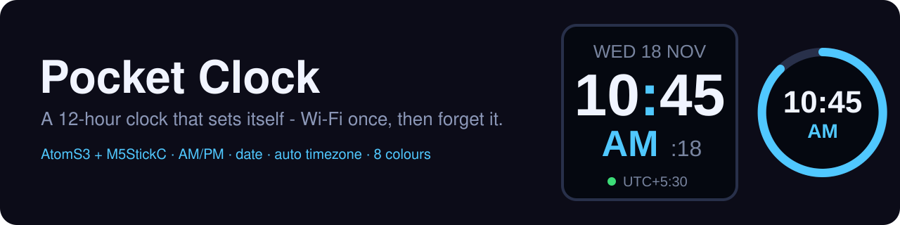
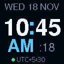
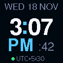
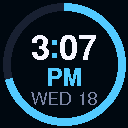

<p align="center">
  
</p>

<p align="center">
  <b>A 12-hour digital clock for the M5Stack AtomS3.</b><br>
  AM/PM &middot; date &middot; 3 watch faces &middot; sets itself over Wi-Fi once &middot; finds your timezone automatically
</p>

<p align="center">
  <a href="https://electroiot.github.io/M5-Pocket-Clock/flasher/"><b>Install in your browser</b></a> &middot;
  <a href="docs/FLASHING.md">Flashing guide</a> &middot;
  <a href="#first-setup">First setup</a> &middot;
  <a href="docs/HOW_IT_WORKS.md">How it works</a> &middot;
  <a href="docs/M5BURNER.md">M5Burner</a>
</p>

<p align="center">
  
</p>

## Watch faces

Click the screen to switch face. All pictures are real frames from the AtomS3 (`tools/shot.py`); the
time was set with a console command so every picture shows the same readable time.

| Digital | Ring | Night |
|:---:|:---:|:---:|
|  |  |  |
|  |  |  |

- **Digital** - big 12-hour time with a blinking colon, AM/PM, seconds, date and a sync dot
  (green = synced, amber = old, red = never synced).
- **Ring** - the time with a seconds ring around the edge.
- **Night** - just a dim time, nothing else, for a bedside table.

Six colours: hold the screen for 0.6 s to change.

## First setup

<table><tr>
<td valign="top">

1. Power the AtomS3. The screen says **WI-FI SETUP**.
2. On your phone join the Wi-Fi **ClockSetup** (the setup page opens by itself, or go to `192.168.4.1`).
3. Pick your home Wi-Fi, enter the password, press **Save**.
4. The clock gets the time in a few seconds and finds your timezone from the internet.

</td>
<td></td>
</tr></table>

You enter the Wi-Fi **once**. After that it syncs by itself every 6 hours (Wi-Fi is switched off in
between to save power), so the time stays right. If your Wi-Fi changes, hold the screen for 3 seconds to run setup again.

## Controls

| You do | It does |
|---|---|
| Click the screen | next watch face |
| Hold 0.6 s, release | next colour |
| Hold 3 s, release | Wi-Fi setup again |
| Pick it up | full brightness for 8 s |

The screen dims between 10 PM and 6 AM. Face, colour, timezone and Wi-Fi are remembered.

## Install

- **Browser (easiest):** open the [web installer](https://electroiot.github.io/M5-Pocket-Clock/flasher/) in Chrome or Edge.
- **M5Burner:** search *Pocket Clock* (device type ATOMS3).
- **esptool:** `esptool.py --chip esp32s3 --port COM9 write_flash 0x0 M5-Pocket-Clock-atoms3-v1.0.0-full.bin` from the [Releases](../../releases) page.
- **PlatformIO:** `git clone`, then `pio run -e atoms3 -t upload`.

Details and download-mode tips: [docs/FLASHING.md](docs/FLASHING.md).

## Hardware

| | |
|---|---|
| Board | [M5Stack AtomS3](https://docs.m5stack.com/en/core/AtomS3) (ESP32-S3) - the version **with the display** |
| Wi-Fi | only for setup and for a quick sync every 6 hours |
| Battery | the AtomS3 has none, so it keeps time while powered over USB and re-syncs after a power cut |

Libraries: M5Unified, WiFiManager, ArduinoJson.

## Privacy

Your Wi-Fi name and password are stored only on the device. The clock talks to NTP servers for the time
and to `ip-api.com` once per sync to find your timezone (it sees your public IP like any website would).
To avoid that, set a fixed timezone: in the setup page enter your UTC offset and set auto timezone to 0.

## Repository

```
src/main.cpp        the whole firmware
platformio.ini      build config (atoms3; StickC build coming)
tools/shot.py       screenshots / GIF over USB
docs/               guides, images, screenshots, web installer (docs/flasher)
```

## License

MIT - see [LICENSE](LICENSE).
