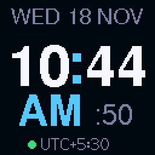
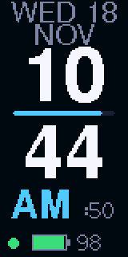
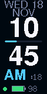
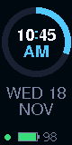
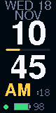
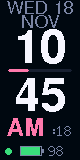
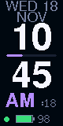
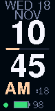
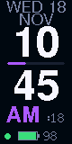

<p align="center">
  
</p>

<p align="center">
  <b>A 12-hour digital clock for the M5Stack AtomS3 and M5StickC.</b><br>
  AM/PM &middot; date &middot; 3 watch faces &middot; 8 colours &middot; sets itself over Wi-Fi once &middot; finds your timezone automatically
</p>

<p align="center">
  <a href="https://electroiot.github.io/M5-Pocket-Clock/flasher/"><b>Install in your browser</b></a> &middot;
  <a href="docs/FLASHING.md">Flashing guide</a> &middot;
  <a href="#first-setup">First setup</a> &middot;
  <a href="docs/HOW_IT_WORKS.md">How it works</a> &middot;
  <a href="docs/M5BURNER.md">M5Burner</a>
</p>

<p align="center">
  
  &nbsp;&nbsp;
  
</p>

## Watch faces

Click the front button to switch face. All pictures are real frames from the devices (`tools/shot.py`);
the time was set with a console command so every picture shows the same readable time.

### AtomS3 (128x128)

| Digital | Ring | Night |
|:---:|:---:|:---:|
|  |  |  |

### M5StickC (80x160) - with battery level

| Digital | Ring | Night |
|:---:|:---:|:---:|
|  |  |  |

- **Digital** - big 12-hour time, AM/PM, seconds, date and a sync dot
  (green = synced, amber = old, red = never synced). The StickC adds a seconds bar and the battery.
- **Ring** - the time with a seconds ring around it.
- **Night** - just a dim time, nothing else, for a bedside table.

### 8 colours

Hold the front button for 0.6 s (or press the StickC's side button) to change colour:
blue, yellow, pink, green, orange, lavender, **light orange** and **purple**.

| | | | | |
|:---:|:---:|:---:|:---:|:---:|
|  |  |  |  |  |

## First setup

<table><tr>
<td valign="top">

1. Power the device. The screen says **WI-FI SETUP**.
2. On your phone join the Wi-Fi **ClockSetup** (the setup page opens by itself, or go to `192.168.4.1`).
3. Pick your home Wi-Fi, enter the password, press **Save**.
4. The clock gets the time in a few seconds and finds your timezone from the internet.

</td>
<td></td>
<td></td>
</tr></table>

You enter the Wi-Fi **once**. After that it syncs by itself every 6 hours (Wi-Fi is switched off in
between to save power), so the time stays right. If your Wi-Fi changes, hold the front button for 3 seconds
to run setup again.

## Controls

| You do | It does |
|---|---|
| Click the front button / AtomS3 screen | next watch face |
| Hold 0.6 s, release (or StickC side button) | next colour |
| Hold 3 s, release | Wi-Fi setup again |
| Pick it up | full brightness for 8 s |

The screen dims between 10 PM and 6 AM. Face, colour, timezone and Wi-Fi are remembered.

## Install

- **Browser (easiest):** open the [web installer](https://electroiot.github.io/M5-Pocket-Clock/flasher/) in Chrome or Edge and pick your device.
- **M5Burner:** search *Pocket Clock* (device type ATOMS3 or STICKC).
- **esptool:** from the [Releases](../../releases) page, e.g.
  `esptool.py --chip esp32s3 --port COM9 write_flash 0x0 M5-Pocket-Clock-atoms3-v1.1.0-full.bin` (AtomS3) or
  `esptool.py --chip esp32 --port COM18 write_flash 0x0 M5-Pocket-Clock-stickc-v1.1.0-full.bin` (StickC).
- **PlatformIO:** `git clone`, then `pio run -e atoms3 -t upload` or `pio run -e m5stickc -t upload`.

Details and download-mode tips: [docs/FLASHING.md](docs/FLASHING.md).

## Hardware

| | AtomS3 | M5StickC |
|---|---|---|
| Board | [AtomS3](https://docs.m5stack.com/en/core/AtomS3) (with display) | original [M5StickC](https://docs.m5stack.com/en/core/m5stickc) (not Plus/Plus2) |
| Screen | 128x128 | 80x160 portrait |
| Battery | none: after a power cut it re-syncs within seconds | built in: level shown, and the **RTC chip keeps the time** through power cuts |
| Buttons | the screen | A (front), B (side) |

Libraries: M5Unified, WiFiManager, ArduinoJson.

## Privacy

Your Wi-Fi name and password are stored only on the device. The clock talks to NTP servers for the time
and to `ip-api.com` once per sync to find your timezone (it sees your public IP like any website would).
To avoid that, set a fixed timezone: in the setup page enter your UTC offset and set auto timezone to 0.

## Repository

```
src/main.cpp        the whole firmware (both devices)
platformio.ini      build config: env atoms3, env m5stickc
tools/shot.py       screenshots / GIF over USB
docs/               guides, images, screenshots, web installer (docs/flasher)
```

## License

MIT - see [LICENSE](LICENSE).
